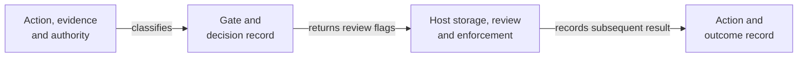

> **Research status, 11 November 2026: reference implementation with bounded fixture evidence.**
>
> **Held:** A specification, reference implementation and checks on record structure, selected routing rules and signed demonstration receipts.
>
> **Open:** Factual truth of records, reviewer understanding, host enforcement and effective control in a deployed setting. The upstream receipt driver remains in review; fixture checks do not establish full protocol conformance or upstream acceptance.

<h1>
<picture>
  <source media="(max-width: 600px)" srcset="assets/research/v1/banner-mobile-dark.svg">
  
</picture>
</h1>

[](RESEARCH.md) [](CITATION.cff) [](LICENSE)

What should a decision record preserve before an AI-informed action proceeds? Governed Decision Intelligence (GDI) connects the proposed action with evidence, authority, uncertainty and intervention conditions. [Research question](docs/research-summary.md).

[Policy reader: understand in 90 seconds](#research-in-90-seconds) · [Reviewer: inspect evidence and limits](docs/current-review.md) · [Engineer: run the checks](docs/reference-verification.md)

## At a glance

| | Current account |
| :--- | :--- |
| Purpose | Make the grounds for a consequential decision reconstructable. [Question and contribution](docs/research-summary.md) |
| Status | Reference implementation with bounded fixture evidence. [Claim register](RESEARCH.md) |
| Evidence type | Schemas, an illustrative record, classifier tests and signed demonstration receipts. [Validation scope](docs/validation-and-reproducibility.md) |
| Version | Citation: 3.0, April 1, 2026. Schema: 2.0. Working applicability specification: 0.2.0. [Version guide](docs/current-review.md#versions-and-publication) |
| License | Declared Apache-2.0. [Preserved license](LICENSE) · [attribution](NOTICE) |
| Cite | [10.5281/zenodo.20244601](https://doi.org/10.5281/zenodo.20244601) · [existing citation metadata](CITATION.cff) |

The checks support specific behavior on supplied inputs. Factual accuracy, effective human review and institutional benefit require separate evidence. Contract discrepancies remain visible in the [current review guide](docs/current-review.md#known-limits). [Research limits](docs/limitations.md).

## Research in 90 seconds

Permission to act leaves questions about the decision itself. A reviewer may need to know which evidence was available, whose authority applied and what could have changed the outcome. GDI proposes a record that preserves those questions before action. [Research account](docs/research-summary.md).

The contribution has three executable parts. A Governed Decision Record (GDR) is a structured account of a decision. A classifier assigns an action to one of four review categories, called gates. A separate receipt demonstration signs a compact account for interoperability checks. Each part has its own contract. [Schema](schema/gdr.schema.json), [classifier](reference-implementation/gate-classifier/gate_classifier.py), [receipt profile](examples/testvectors-interop/README.md).

The host application carries out storage, human review and action enforcement. A classification result alone leaves those responsibilities with the host. The research asks whether recorded grounds can support reconstruction; field effectiveness remains unestablished. [Classifier API](reference-implementation/gate-classifier/gate_classifier.py), [known limits](docs/limitations.md).

## Method in brief



The text sequence is: supply decision inputs, classify the action, preserve the record, complete host review and enforcement, and record the outcome. The diagram describes the intended integration path. Host enforcement needs its own implementation and evidence. [Classifier](reference-implementation/gate-classifier/gate_classifier.py), [integration pattern](docs/bilateral-pattern.md).

## Evidence and known limits

| Material | What is available | What remains open |
| :--- | :--- | :--- |
| Decision schema | JSON and YAML contracts plus a populated example. [Schema](schema/gdr.schema.json) · [example](schema/gdr.example.json) | Structural validity leaves content accuracy, approval identity and several cross-field obligations unchecked. [Review guide](docs/current-review.md#known-limits) |
| Gate classifier | Deterministic rules and fixture tests. [Implementation](reference-implementation/gate-classifier/gate_classifier.py) · [tests](reference-implementation/gate-classifier/test_gate_classifier.py) | Threshold documentation and implementation differ. The local hash covers a specified subset of fields. [Review guide](docs/current-review.md#known-limits) |
| Receipt demonstration | Three local fixtures and regression checks for a compact signed profile. [Interop guide](examples/testvectors-interop/README.md) | Full-record conformance, real deployment and upstream acceptance need separate evidence. [Dated external review record](docs/scopeblind-contribution-review.md) |
| Working specification | Decision Evidence Applicability Specification (DEAS), a proposal for deciding whether evidence supports a claim in context. [Draft 0.2.0](working-specifications/decision-evidence-applicability-v0.2.md) | Adoption and empirical validation remain open. [Claim register](RESEARCH.md) |

The ScopeBlind record reports status as checked on October 29, 2026. Use it as a dated contribution record. This entry makes no new claim about the current pull request outcome. [Recorded status and attribution](docs/scopeblind-contribution-review.md).

## Reproduce the checks

The [verification guide](docs/reference-verification.md) supplies exact commands for a disposable checkout. Python 3.12 matches the repository's continuous integration environment. A successful aggregate run ends with `repository validation: PASS`. The guide distinguishes software checks from research validation. [Workflow](.github/workflows/ci.yml), [validator](scripts/validate_repository.py).

## AI assistance and human review

The project records Claude assistance with drafting and organization in the historical study. It separately records an AI-assisted adapter review and an external maintainer's technical corrections. The available history leaves task-level model details and a complete human-verification inventory unavailable. [AI-use disclosure](docs/ai-use-disclosure.md), [contribution record](docs/scopeblind-contribution-review.md).

Mark Julius Banasihan retains responsibility for adopted research work. Author acceptance, software tests and independent source verification have different evidentiary scopes. [Project disclosure](docs/ai-use-disclosure.md).

## Cite the work

This entry renders the existing author, title, version, date and DOI in [CITATION.cff](CITATION.cff). Record the exact Git commit when discussing later code or documentation. The [version guide](docs/current-review.md#versions-and-publication) separates the cited work from component versions.

```bibtex
@software{banasihan2026gdi,
  author = {Banasihan, Mark Julius},
  title = {Governed Decision Intelligence: The Decision Architecture for Governed AI},
  year = {2026},
  month = apr,
  version = {3.0},
  doi = {10.5281/zenodo.20244601},
  url = {https://github.com/node-and-norm/governed-decision-intelligence},
  note = {Release date in CITATION.cff: April 1, 2026}
}
```

<details>
<summary>Technical catalog, prior entry and research history</summary>

The [complete prior README](README-2026-11-03.md) preserves the entry at [audit commit 68ac580](https://github.com/node-and-norm/governed-decision-intelligence/tree/68ac580470d6fbd7d3505e3f42c4917fa9bc9582).

- [Material claims and evidence](RESEARCH.md)
- [GDI v3 specification PDF](spec/GDI_v3_The_Decision_Architecture_for_Governed_AI.pdf)
- [Threshold model](docs/confidence-threshold-model.md)
- [Change history](CHANGELOG.md)
- [Contribution policy](CONTRIBUTING.md)

</details>

Research by [Mark Julius Banasihan](https://orcid.org/0009-0001-8121-2878). [Node & Norm](https://nodeandnorm.org/) · [Research integrity](https://nodeandnorm.org/about/research-integrity/).
